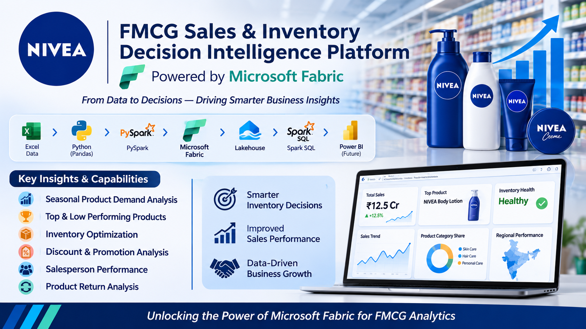
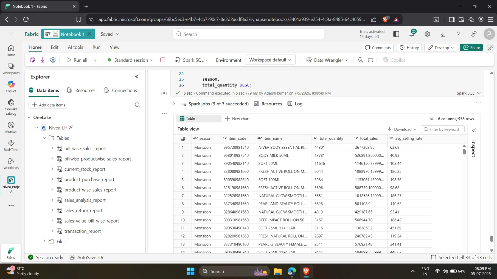
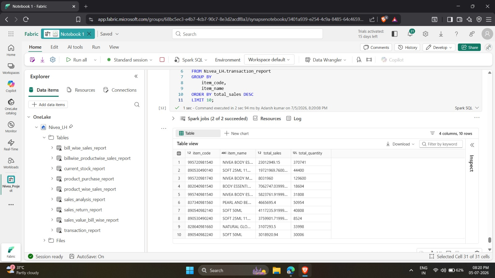
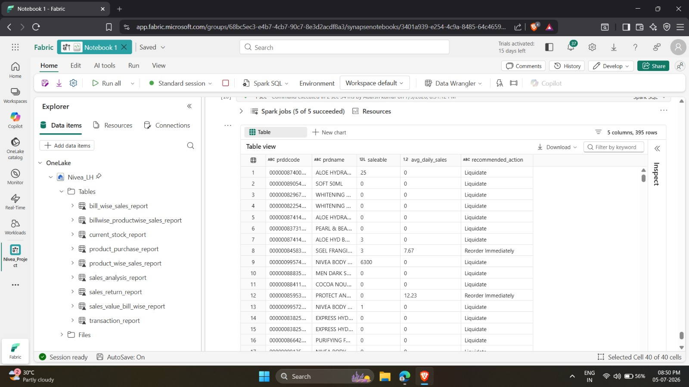
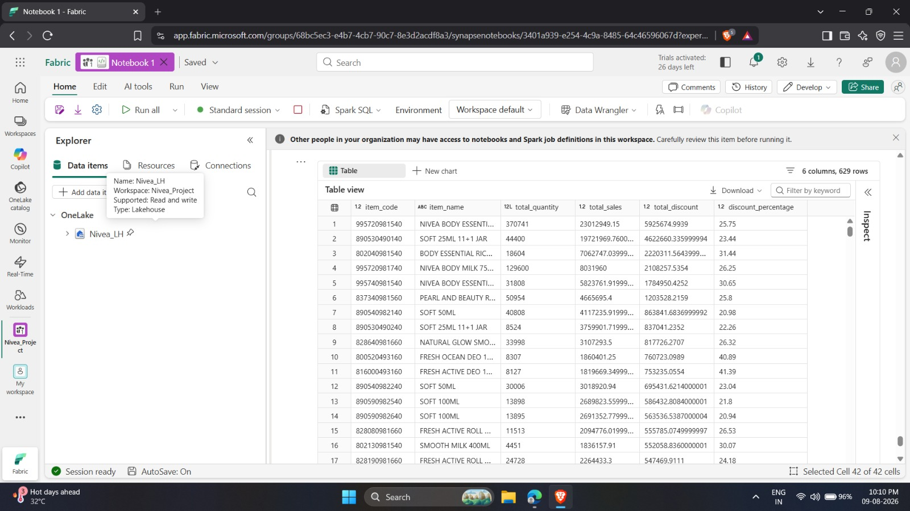
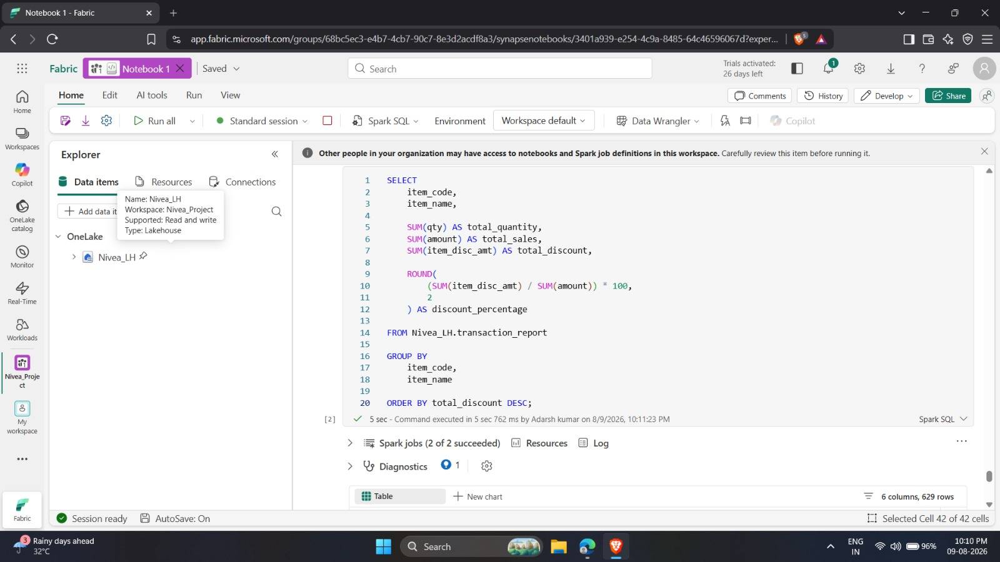

# FMCG Sales & Inventory Decision Intelligence | Microsoft Fabric

> **Portfolio project:** An analytics workflow built in Microsoft Fabric using PySpark, Spark SQL, Pandas and a Lakehouse to turn distributor-level FMCG reports into product, retailer, sales, returns and inventory insights.
>
> 

## Project overview

This project explores how operational Excel reports from an FMCG distribution environment can be ingested into a Microsoft Fabric Lakehouse and analysed to support business decisions.

The notebook uses Pandas to read Excel files, PySpark to convert the data into Spark DataFrames, and Spark SQL to build analytical summaries. The analysis focuses on product demand, sales performance, discounts, retailer activity, inventory health, salesperson performance and product returns.

## Business questions addressed

| Area | Business question | Main analysis |
|---|---|---|
| Seasonal demand | Which products sell in Summer, Monsoon and Winter? | Season classification, product-level quantity and sales aggregation, top products by season |
| Product performance | Which products lead or lag in sales? | Top products by quantity and revenue, product ranking |
| ABC analysis | Which products contribute most to revenue? | Cumulative revenue contribution and A/B/C classification |
| Retailer analysis | Which retailers contribute the most sales? | Retailer-level sales, quantity and ranking |
| Inventory optimization | How much stock cover does each product have? | Average daily sales, stock days and inventory status |
| Stock recommendations | Which products may need action? | Reorder, maintain stock, reduce purchase/run promotion or liquidate recommendations |
| Discount analysis | How much discount is being given? | Discount value and percentage, discounted vs. non-discounted sales, product-level discount analysis |
| Salesperson performance | Which salespeople and routes generate sales? | Bills, cases, pieces, net sales, ranking and monthly/route summaries |
| Returns analysis | Which products and periods have the most returns? | Return quantity/value by product, month and retailer |

## Technology stack

- **Microsoft Fabric** – notebook and Lakehouse environment
- **OneLake / Lakehouse** – storage and managed analytical tables
- **Python** – notebook orchestration and data preparation
- **Pandas** – Excel ingestion and column preparation
- **PySpark** – conversion of Pandas DataFrames into Spark DataFrames
- **Spark SQL** – transformations, aggregations, CTEs, window functions, ranking and business rules
- **Jupyter Notebook (`.ipynb`)** – project implementation and execution record

## Data architecture

```text
Operational Excel reports
          |
          v
Pandas (read Excel / inspect headers / clean column names)
          |
          v
PySpark DataFrames
          |
          v
Microsoft Fabric Lakehouse / OneLake
          |
          v
Lakehouse tables
          |
          v
Spark SQL transformations and aggregations
          |
          v
Business analysis outputs
(product, retailer, inventory, discount, salesperson and returns)
```

## Lakehouse tables used

The project reference records the following Lakehouse tables:

- `transaction_report`
- `current_stock_report`
- `bill_wise_sales_report`
- `sales_return_report`
- `product_wise_sales_report`
- `billwise_productwise_sales_report`
- `product_purchase_report`
- `sales_analysis_report`
- `sales_value_bill_wise_report`

The main transaction-level analysis uses `transaction_report`. Inventory analysis combines transaction history with `current_stock_report`. Salesperson analysis uses `bill_wise_sales_report`, while returns analysis uses `sales_return_report`.

## Selected analytical logic

### 1. Seasonal product demand

The notebook creates a season from the transaction month:

- March–June: Summer
- July–September: Monsoon
- October–February: Winter

It then aggregates quantity and sales by season and product and ranks products within each season.



These month ranges are **project assumptions**, not confirmed company policy.

### 2. Product ranking and ABC classification

Products are aggregated by sales value and ranked. ABC classification is based on cumulative revenue contribution:

- A: up to 80%
- B: next 15% (up to 95% cumulative)
- C: remaining contribution



### 3. Inventory health and stock cover

Average daily sales are calculated from total quantity divided by the number of distinct selling dates. Stock cover is then estimated as:

```text
Stock days = Current saleable stock / Average daily sales
```

The notebook applies these proposed status bands:

- Below 15 stock days: Reorder
- 15–45 stock days: Healthy
- Above 45 stock days: Overstock
- No recorded sales velocity: Liquidate / investigate




### 4. Discount analysis

The notebook calculates discount value and discount percentage from transaction-level sales and discount fields, and compares discounted with non-discounted transactions.




This is **discount performance analysis, not true promotion ROI**. True ROI or profitability requires reliable product cost and a suitable incremental-sales or control-group methodology.

## Validation and modelling considerations

- The notebook inspects table columns and schemas before building queries.
- It uses confirmed Lakehouse table names rather than assumed names.
- It avoids an unnecessary join for salesperson analysis because the bill-wise table already contains salesperson, route and bill-level sales fields.
- Product-to-stock matching uses `current_stock_report.prddcode` and `transaction_report.item_code`, as recorded in the project reference.
- Joins should be checked for key uniqueness and row multiplication before using the results in a production dashboard.
- The retailer sales and returns keys still require validation before combining them into a retailer risk score.

### Deferred for a future project phase

- Training and evaluating a demand forecasting model (monthly demand aggregation is prepared
- Retailer risk score (retailer key matching and score design remain to be validated)
- Market basket analysis
- Power BI dashboards and a published semantic model
- Reorder recommendation model beyond the current rule-based stock action
- AI-generated insights
